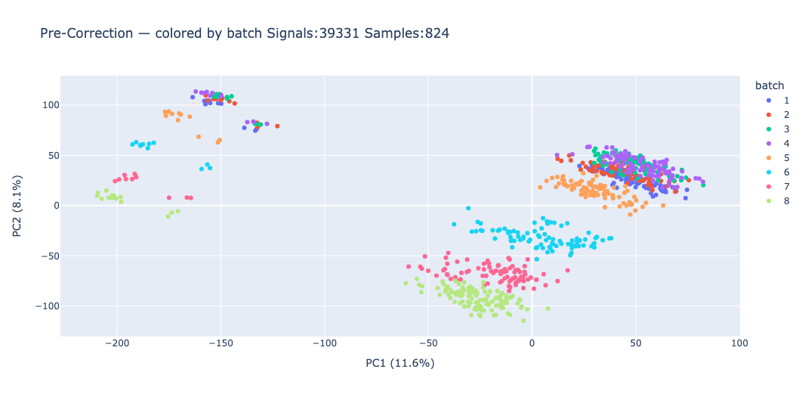
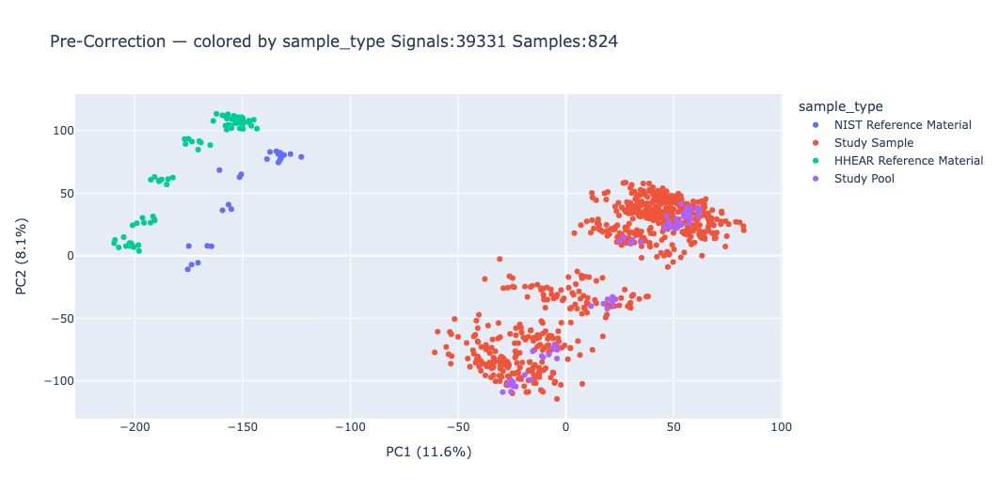
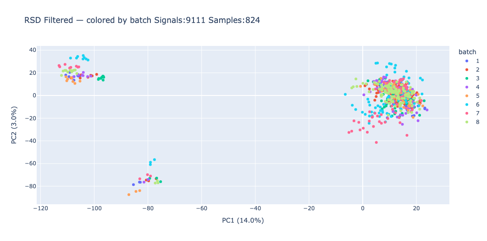
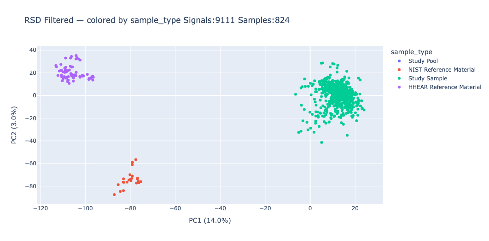

# ST002118 — raw data → mzML → Data Preprocessing Using ADAP-BIG → Feature Table

- Description: *Exposures to Metals in Pregnant Women and the Impact on Fetal Development and Birth Outcomes in Suriname*
- Study ID: (Metabolomics Workbench ST002118) 
- Additional Information: 824 injections. Thermo Q Exactive HF-X, RP (Waters HSS T3), ESI positive.

Source: `ftp://www.metabolomicsworkbench.org/Studies/ST002118_HHEAR_Lichtveld.zip`

## Layout
```
raw/zip/              downloaded archive                         (ignored)
raw/extracted/        unzipped vendor .raw files                 (ignored)
raw/raw_files.txt     sorted list of .raw paths (drives the array job)
containers/           pwiz.sif + build provenance                (ignored)
mzML/                 converted output                           (ignored)
metadata/             sample metadata (see below)
adap_big/             ADAP-BIG workflow, settings, factors, run script
adap_big/runs/        ADAP-BIG project outputs                   (ignored)
logs/                 SLURM logs                                 (ignored; dir must exist)
scripts/              pipeline
st002118-processing/  pixi environment (python, pandas, requests, mwtab)
```


| Stage | Features × injections |
|---|---|
| ADAP-BIG between-batch aligned features | 39,331 × 824 |
| SERRF (TIC normalization, Study Pool QCs, run per batch) | 39,331 × 824 |
| RSD filter (NIST nonparametric CV ≤ 30%) | **9,111** × 824 |

### PCA scores

| | Colored by batch | Colored by sample type |
|---|---|---|
| **Pre-correction** |  |  |
| **SERRF + RSD filter** |  |  |

- **Pre-correction:** there is a strong batch effect. Batches 1–5 and 6–8 separate on PC2, and this
  happens for every sample type, including the QCs.
- **SERRF:** the Study Pool QCs collapse into one tight cluster, and batch 5 now overlaps batches 1–4.
  With all 39k features included, study samples still split into a batch 1–5 group and a batch 6–8 group.
- **RSD filter:** batches mix within each sample type. Study samples, NIST and HHEAR form three
  separate clusters, and the pools sit inside the study-sample cluster as expected.
- The RSD-filtered PCA is log-transformed (`applylog=True`) and the other two are not, so do not
  compare axis scales across rows.

### Output files
`results/` is git-ignored because the files exceed GitHub's 100 MB limit. They are regenerated by the steps below.

| File | Contents |
|---|---|
| `ST002118_aligned_features.csv` (849 MB) | ADAP-BIG aligned features with per-sample RT, height, area and m/z |
| `ST002118_aligned_features_msms.msp` (102 MB) | 115,741 MS/MS spectra. `Name` = `#<id> <mz>@<rt> MS1+` links each spectrum to its feature |
| `st002118_feature_table.parquet` (283 MB) | Injections × features matrix of heights. Missing values are set to 10% of the sample minimum |
| `ST002118_Batch_Corrected.csv` (598 MB) | SERRF-corrected matrix |

The RSD-filtered table is computed in the notebook and is not saved to a file.

## Reproduce
```bash
cd /users/j/a/jaileru/ST002118-Processing
sbatch scripts/01_download.sbatch                    # Workbench zip (87 GB), resumable
sbatch scripts/02_extract.sbatch
srun -p interact --mem=16G -t 2:00:00 --pty bash scripts/03_pull_container.sh   # pwiz.sif

N=$(wc -l < raw/raw_files.txt); FPT=10               # 04: msconvert (centroided, all MS levels)
sbatch --array=0-$(( (N+FPT-1)/FPT - 1 ))%40 --export=ALL,FILES_PER_TASK=$FPT scripts/04_msconvert_array.sbatch

python scripts/generate_metadata_file.py             # 05: sample metadata + ADAP-BIG factors
sbatch adap_big/ADAP-ST002118.sh                     # 06: ADAP-BIG workflow
sbatch adap_big/ADAP-export-aligned.sh               # 07: export aligned features (.csv + .msp)
# 08: build the parquet feature table (notebooks/generate_analysis.ipynb, cell 2), then run SERRF (~7 h, 400 GB)
cd scripts && sbatch run_st002118_batch_effect_correction.sh
# 09: PCA plots + RSD filter: notebooks/generate_analysis.ipynb
```
The repo-root `pixi.toml` is the environment for the pipeline scripts. The ADAP-BIG jar
(`adap_big/adap-big-console-app-v1.6.0.jar`) is not tracked.

### Pinned dependencies
Post-processing code is included as git submodules, each pinned to the `v1.0.0` release used for these results:

| Submodule | Commit | Used for |
|---|---|---|
| [`repos/serrf-py`](https://github.com/JulianAileru/serrf-py/tree/v1.0.0) | `b3d8570` | SERRF batch-effect correction (step 08, run through `uv`) |
| [`repos/metabolomics-toolkit`](https://github.com/JulianAileru/metabolomics-toolkit/tree/v1.0.0) | `67a0b3d` | PCA plots and CV/RSD filter (step 09) |

```bash
git clone --recurse-submodules https://github.com/JulianAileru/ST002118-Processing.git
# or, in an existing clone:
git submodule update --init
```

## Metadata
`scripts/generate_metadata_file.py` combines three sources:
- the Workbench mwTab, which gives the sample type and file name;
- `metadata/Lichtveld Prep List.docx` (not tracked), which gives the **batch**;
- mzML start timestamps, which give the **injection order**.

The join key is the prep-list DRCC ID `S_1` ↔ raw file `Lich_S_1`. Outputs are
`metadata/sample_metadata.csv` (824 rows) and `adap_big/ST002118_metadata.csv` (the ADAP-BIG factors file).

- Prep order is not the same as injection order. Each batch runs NIST first, then repeats
  [10 study samples, HHEAR, SP], and ends with NIST (2021-11-05 → 2021-11-25).
- 76 prep-list rows have no file on the Workbench (68 blanks plus 8 samples), so this study has no blank injections.

| batch | 1 | 2 | 3 | 4 | 5 | 6 | 7 | 8 |
|---|---|---|---|---|---|---|---|---|
| study | 80 | 80 | 80 | 80 | 80 | 77 | 79 | 112 |
| sp (Study Pool) | 8 | 7 | 8 | 8 | 6 | 8 | 8 | 11 |
| hhear | 8 | 8 | 8 | 8 | 8 | 8 | 8 | 12 |
| nist | 3 | 3 | 3 | 3 | 3 | 3 | 3 | 3 |

## ADAP-BIG notes
- Background removal is dropped from `workflow.xml` because there are no blanks. The between-batch aligner reads `aligned_component` instead.
- Sample-type keywords: `sp` → Pool (alignment reference), `nist` → standard, `hhear` → other.
- Step outputs in `adap_big/runs/` are `.ser` files (Java serialized objects). They are not feature tables.
  Tables come from the Output module (`ADAP-export-aligned.sh`), which needs `--multi-batch ALL_BATCHES`
  and picks the format from the `--output` extension (`.csv`, `.msp` or `.pdf`).
- The Output module logs `OutputModule is finished` even when an argument is bad. Check the log text, not just the job status.
